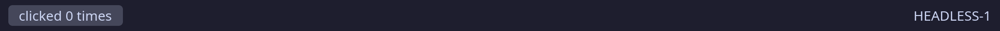

# crabshell

a wayland bar toolkit, like quickshell, except your bar is a rust crate. the first release targets sway and other wlroots compositors



the counter example, drawn at scale 2

status: early. bars draw, take clicks and follow monitors as they come and go. the clock, workspaces, audio and the tray come next, and nothing is on crates.io yet

### try it

needs rust 1.99 or newer, fontconfig, and sway or another wlroots compositor

```sh
cargo run --release -p crabshell --example counter
```

a 30 px bar shows up at the top of every monitor. click the button to count

### a bar

```rust
use crabshell::prelude::*;

fn main() {
    crabshell::run(|cx| cx.per_output(bar));
}

fn bar(cx: &Cx, output: &Output) -> PanelWindow {
    let count = cx.signal(0_u32);
    PanelWindow::new(output)
        .anchors(Edge::Top | Edge::Left | Edge::Right)
        .height(30)
        .child(
            Row::new()
                .padding(4, 8)
                .child(
                    Button::new(Text::new(move || format!("clicked {} times", count.get())))
                        .on_click(move |_| count.update(|n| *n += 1)),
                )
                .child(Spacer::new())
                .child(Text::new(output.name())),
        )
}
```

every widget property takes a value or a closure. a closure runs again when a signal it reads changes, and only what changed is redrawn. `per_output` builds a bar for every monitor, now and later, and drops it when the monitor goes. the full example, with styles and hover, is [examples/counter.rs](crates/crabshell/examples/counter.rs)

### numbers

the counter example on a 1920×1080 screen under swayfx

~ 13 MiB of memory\
~ first frame in 13 ms\
~ zero wakeups while idle

for comparison, quickshell drawing the [phase 0 test bar](spike/RESULTS.md) uses 125 MiB and needs 219 ms to its first frame

### what's in it

~ [crabshell](crates/crabshell/), `run()`, `per_output`, the prelude and the example\
~ [crabshell-reactive](crates/crabshell-reactive/), signals, memos, effects and owners\
~ [crabshell-ui](crates/crabshell-ui/), widgets, styles, layout, text and hit testing\
~ [crabshell-render](crates/crabshell-render/), drawing on the cpu with tiny-skia, damage tracking, glyphs and icons\
~ [crabshell-wayland](crates/crabshell-wayland/), the event loop, layer-shell windows, buffers, scaling, the pointer and monitors\
~ [spike](spike/) and [baseline](baseline/), the phase 0 prototype and the quickshell bar it was measured against

### tests

```sh
cargo test --workspace
```

the headless sway tests are skipped by default. run them from a terminal your desktop sway started

```sh
cargo test -p crabshell-wayland --test headless -- --ignored --test-threads=1
cargo test -p crabshell --test headless -- --ignored --test-threads=1
```

they need `sway`, `swaymsg` and `grim`, and each test runs its own private sway. `CRABSHELL_BLESS=1` rewrites the golden images, which expect noto sans as your `sans-serif`. if sway gets killed at startup, the test says why

_license: [mit](./LICENSE-MIT) or [apache-2.0](./LICENSE-APACHE), your choice_
